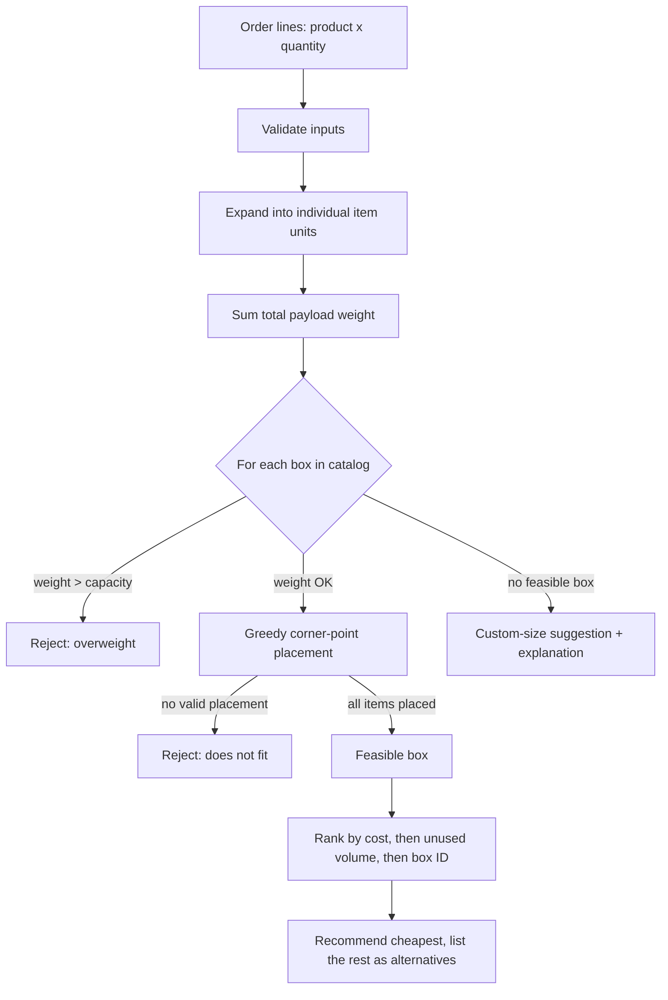

# AI-Assisted Box Selection System

A Django warehouse-fulfillment dashboard that takes an order of one or more products and recommends the **lowest-cost shipping box that physically fits**. The packing logic checks real 3D placement, rotation, and weight limits, and does not rely on a volume comparison alone.

---

## Table of contents

- [Features](#features)
- [How box selection works](#how-box-selection-works)
- [Architecture](#architecture)
- [Tech stack](#tech-stack)
- [Getting started](#getting-started)
- [Usage walkthrough](#usage-walkthrough)
- [Sample data](#sample-data)
- [Routes](#routes)
- [Testing](#testing)
- [Project structure](#project-structure)
- [Configuration and deployment notes](#configuration-and-deployment-notes)
- [Known limitations](#known-limitations)
- [Roadmap](#roadmap)
- [Documentation index](#documentation-index)
- [Author](#author)

---

## Features

**Box recommendation**
- Accepts multi-product orders with quantities.
- Checks physical placement of every item unit with a corner-point packing strategy, not just total volume.
- Supports per-product rotation (all six axis-aligned orientations) or a fixed orientation.
- Rejects boxes whose maximum payload weight would be exceeded.
- Selects the lowest-cost feasible catalog box and lists the other suitable boxes as alternatives.
- Produces a plain-language explanation for every result, including a clear *no suitable box* message.
- Falls back to a custom-size suggestion (2 cm clearance per side, unpriced) when the catalog is empty or no catalog box is feasible.

**Warehouse workflow**
- Staff-only product and shipping-box management (create, view, update, delete) with validation.
- Order creation with multiple lines, quantity validation, and transactional saving.
- Product snapshots on each order line, so later catalog edits do not change historical orders.
- Draft → **Placed** order placement, gated on a saved catalog-box recommendation.
- Confirmation-protected deletion of individual order history.
- Recommendations are invalidated automatically when a box or an order's lines change.
- Optional box tare weight, with a gross shipment weight estimate when tare is known.

**Dashboard**
- Responsive sidebar workspace (Django templates, Bootstrap, Tailwind via CDN).
- Order search with a `Ctrl+K` shortcut, dark mode, copyable short order IDs, and status and packaging badges.
- Warehouse analytics page: order counts, placed-order weights, catalog coverage, and box utilization.

---

## How box selection works

The selector lives in [`box_selection/algorithms/box_selector.py`](./box_selection/algorithms/box_selector.py) and has **no Django dependency**, so it can be tested and reused on its own.



**Placement strategy**
1. Expand each order line into individual units and sort them largest-volume first.
2. Start with one candidate corner point at the box origin.
3. For each unit, try candidate points in order (lowest `z`, then `y`, then `x`) and every allowed orientation.
4. Accept the first placement that stays inside the box's internal dimensions and does not overlap any placed item.
5. After each placement, add three new corner points (along `x`, `y` and `z`).
6. If any unit cannot be placed, the box is rejected.

**Ranking:** feasible boxes are ordered by **cost**, then **unused volume**, then **box ID**, so results are fully deterministic.

---

## Architecture

The project keeps responsibilities separated inside a single Django app, `box_selection`:

| Layer | File | Responsibility |
|---|---|---|
| Algorithm | `algorithms/box_selector.py` | Pure-Python packing and ranking. No Django imports. |
| Services | `services.py` | `create_order`, `recommend_box_for_order`, `place_order`. Transactions and persistence. |
| Models | `models.py` | `Product`, `Box`, `Order`, `OrderItem`, `BoxRecommendation`, with DB constraints. |
| Forms | `forms.py` | Input validation and error messages. |
| Views | `views.py` | HTTP handling only. Staff-only access. |
| Templates / static | `templates/`, `static/` | Dashboard UI. |

Views call services, and services call the algorithm. Packing rules are not duplicated in views or templates.

**Data model**

- `Product` holds SKU, name, description, category, INR price, dimensions, weight and a rotation preference.
- `Box` holds internal dimensions, maximum payload weight, optional tare weight and cost.
- `Order` has a status of `draft`, `placed` or `cancelled`, and a UUID `number`.
- `OrderItem` holds product, quantity and a snapshot of the packing inputs.
- `BoxRecommendation` is one per order and holds the selected box snapshot, alternatives, score and explanation.

---

## Tech stack

- **Backend:** Python 3.14, Django 6.x (`Django>=6.0,<7.0`)
- **Database:** SQLite (local development)
- **Frontend:** Django templates, Bootstrap, Tailwind CSS (CDN), vanilla JavaScript
- **Testing:** Django `TestCase` / `SimpleTestCase`

---

## Getting started

### Prerequisites

- Python 3.14 (the version used for the recorded test run; other versions have not been verified)
- Git

### Installation (Windows PowerShell)

```powershell
git clone https://github.com/<your-username>/<your-repository>.git
cd <your-repository>

py -3.14 -m venv .venv
.\.venv\Scripts\Activate.ps1
python -m pip install --upgrade pip
python -m pip install -r requirements.txt

python manage.py migrate
python manage.py seed_box_data
python manage.py createsuperuser
python manage.py runserver
```

If PowerShell blocks script activation, call the interpreter directly instead, for example `.\.venv\Scripts\python.exe manage.py runserver`.

### macOS / Linux

```bash
python3 -m venv .venv
source .venv/bin/activate
pip install -r requirements.txt
python manage.py migrate
python manage.py seed_box_data
python manage.py createsuperuser
python manage.py runserver
```

> The setup commands above were recorded and tested on Windows. The macOS/Linux equivalents use the same Django commands but have not been run for this project.

Then open <http://127.0.0.1:8000/orders/> and sign in with the staff account you created. Warehouse pages require a staff user.

The workspace pages need internet access in the browser to load the Bootstrap and Tailwind CDN assets.

---

## Usage walkthrough

1. **Seed the catalog** with `python manage.py seed_box_data`, or add products and boxes under `/products/` and `/boxes/`.
2. **Create an order** at `/orders/add/`. Add several products with quantities. Empty orders, zero or negative quantities and duplicate products are rejected.
3. **Review the recommendation** on the order page: order ID, products and quantities, total payload weight, recommended box, dimensions, weight capacity, cost, explanation and alternative boxes.
4. **Place the order** from the order detail page or the row action menu. Only a draft with a saved catalog-box recommendation can be placed.
5. **Delete history** for a single order from its action menu. This removes only that order, its lines and its recommendation. Products and boxes are kept.

---

## Sample data

`python manage.py seed_box_data` is idempotent and safe to run repeatedly. It creates or updates 10 products (identified by `SAMPLE-…` SKUs) and 5 boxes.

| Box | Internal size (cm) | Max weight | Cost (₹) |
|---|---|---|---|
| Small | 20 × 15 × 10 | 2 kg | 20 |
| Medium | 35 × 25 × 15 | 5 kg | 35 |
| Large | 45 × 35 × 20 | 10 kg | 50 |
| Extra Large | 55 × 40 × 30 | 15 kg | 70 |
| Premium | 65 × 50 × 40 | 25 kg | 100 |

Sample products are Smartphone, Laptop, Headphones, Water Bottle, Coffee Mug, Keyboard, Mouse, Shoes, Backpack and Tablet. Prices and box costs are illustrative INR values only.

---

## Routes

All routes require a signed-in staff user.

| Path | Purpose |
|---|---|
| `/products/` | Product list, with add, detail, edit and delete under `/products/…` |
| `/boxes/` | Shipping box list, with add, detail, edit and delete under `/boxes/…` |
| `/orders/` | Orders workspace |
| `/orders/add/` | Create an order |
| `/orders/<id>/` | Order detail and recommendation dashboard |
| `/orders/<id>/recommend/` | Recalculate the recommendation (POST) |
| `/orders/<id>/place/` | Place a draft order (POST) |
| `/orders/<id>/delete/` | Delete order history (confirmation page) |
| `/analytics/` | Warehouse analytics |
| `/admin/` | Django admin |

---

## Testing

```powershell
python manage.py test box_selection
python manage.py check
python manage.py makemigrations --check --dry-run
```

The test suite has **77 tests** across the selector, services, CRUD views, orders, sample data and dashboard UI. It covers:

- single-product fit and exact-boundary fits
- rotation allowed and disabled
- multiple products in one box
- products that exceed every box's dimensions
- weight capacity violations and the weight-equals-capacity boundary
- lowest-cost selection and equal-cost tie-breaking
- invalid dimensions, costs and quantities
- empty orders and an empty box catalog
- all 10 sample products, and idempotent seeding
- order placement rules, staff-only access and protected deletion

Recorded command output is in [`TEST_OUTPUT.md`](./TEST_OUTPUT.md), and each scenario is described in [`TEST_CASES.md`](./TEST_CASES.md).

---

## Project structure

```text
.
├── README.md
├── AI_USAGE.md
├── TEST_CASES.md
├── TEST_OUTPUT.md
├── requirements.txt
├── manage.py
├── config/                     # Django project settings and root URLs
│   ├── settings.py
│   ├── urls.py
│   ├── asgi.py
│   └── wsgi.py
└── box_selection/              # Main application
    ├── algorithms/
    │   └── box_selector.py     # Framework-independent packing algorithm
    ├── management/commands/
    │   └── seed_box_data.py    # Idempotent sample-data seeder
    ├── migrations/
    ├── static/box_selection/   # css/dashboard.css, js/workspace.js
    ├── templates/box_selection/
    ├── admin.py
    ├── forms.py
    ├── models.py
    ├── services.py
    ├── urls.py
    ├── views.py
    └── test_*.py               # Selector, services, management, orders, sample data, UI
```

---

## Configuration and deployment notes

Development defaults are `DEBUG=True` with a local-only secret key. **Do not deploy with these defaults.** Configure the following through environment variables:

| Variable | Purpose |
|---|---|
| `DJANGO_DEBUG` | Set to `false` in production. |
| `DJANGO_SECRET_KEY` | Required when debug is off. Use a unique, private value. |
| `DJANGO_ALLOWED_HOSTS` | Comma-separated production hostnames. Required when debug is off. |
| `DJANGO_SECURE_SSL_REDIRECT` | HTTPS redirect (defaults to `true`). |
| `DJANGO_SECURE_HSTS_SECONDS` | HSTS duration (defaults to `0`). |
| `DJANGO_SECURE_HSTS_INCLUDE_SUBDOMAINS` | Optional HSTS setting. |
| `DJANGO_SECURE_HSTS_PRELOAD` | Optional HSTS setting. |

Additional notes:

- `.env` is git-ignored, but the project does **not** load `.env` files automatically.
- The Tailwind CDN is meant for development. Compile Tailwind to static assets before production.
- SQLite is used for local development. Choose a production database before deploying.
- `db.sqlite3`, `.venv/` and `.env` are excluded by `.gitignore`. Do not commit them.

---

## Known limitations

- **Heuristic packing.** Greedy corner-point placement can reject a box that could physically hold the items. A "no fit" result is not proof that no arrangement exists, and optimal packing is not guaranteed.
- **Single box per order.** Orders that would need several boxes are not split. Selection supports at most 100 individual item units.
- **Rigid cuboids only.** Items and boxes are modeled as axis-aligned rectangular solids, in centimetres and kilograms.
- **No padding model.** Cushioning, packaging thickness, fragile or stackable rules, keep-upright constraints other than the per-product rotation flag, carrier limits and dimensional-weight pricing are not modeled.
- **Payload weight.** Box capacity is compared against product weight. Tare is reported separately and does not reduce capacity.
- **Custom suggestions are unpriced.** The fallback uses a simple single-row layout and has no cost or tare information.
- **Settings** in the sidebar is a disabled placeholder.
- **Scope of verification.** Results were recorded on one Windows machine with SQLite. No production deployment, load test or cross-browser test is claimed.

---

## Roadmap

- Multi-box order splitting
- Fragility, stackability and keep-upright handling
- Carrier rate and dimensional-weight integration
- Packing visualization (3D view of item placement)
- Compiled Tailwind assets and a production database configuration
- Settings page and role-based permissions beyond staff access
- Optional ML-based ranking layered on top of the deterministic hard checks

---

## Documentation index

| File | Contents |
|---|---|
| [`TEST_CASES.md`](./TEST_CASES.md) | Every test scenario and why it matters |
| [`TEST_OUTPUT.md`](./TEST_OUTPUT.md) | Recorded test and check output |
| [`AI_USAGE.md`](./AI_USAGE.md) | How AI assistance was used while building this project |

---

## Author

**Manish Kumar**, Bengaluru, India
GitHub: [github.com/Manishkr2703](https://github.com/Manishkr2703) · Email: krmanish2703@gmail.com

## License

No license has been chosen yet. Add a `LICENSE` file (for example MIT) before sharing the code for reuse.
